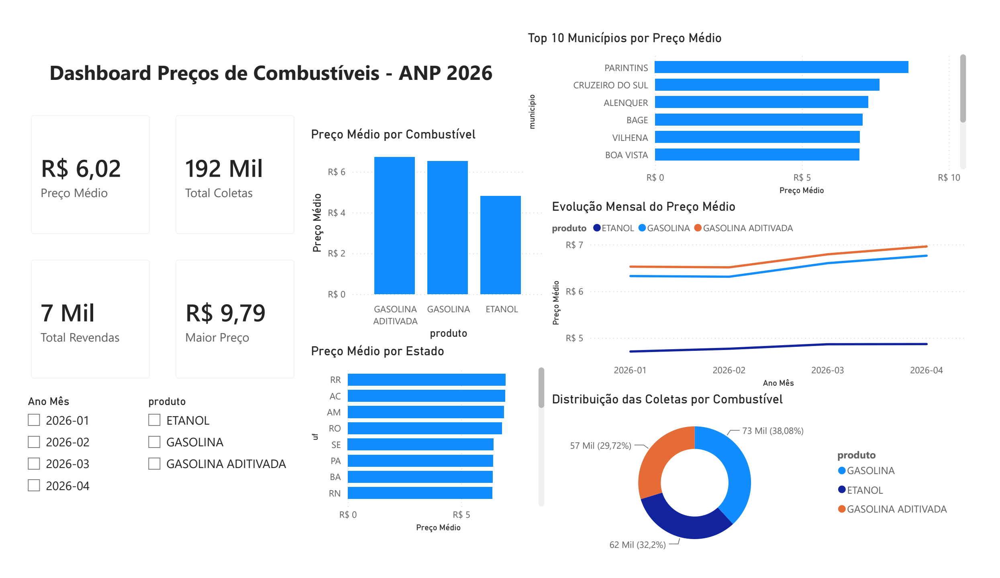
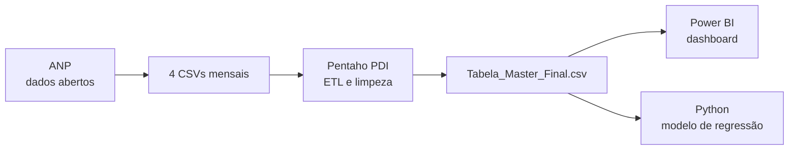
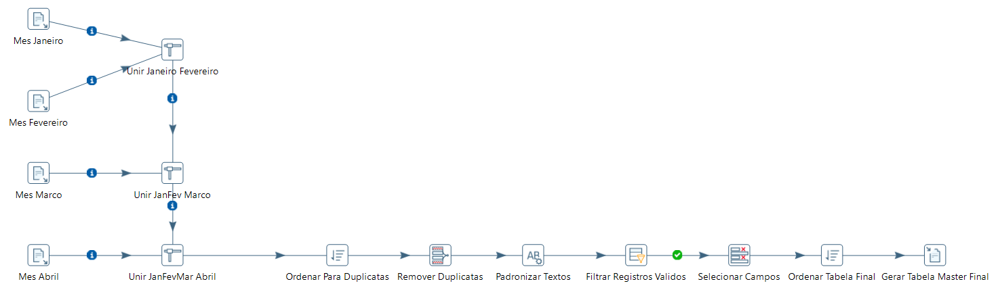

# Preços de Combustíveis no Brasil: pipeline de dados ANP 2026

Pipeline de dados de ponta a ponta com a Série Histórica de Preços de Combustíveis da ANP (Agência Nacional do Petróleo, Gás Natural e Biocombustíveis), de janeiro a abril de 2026. O projeto vai do arquivo bruto ao painel: ETL no Pentaho, dashboard no Power BI e um modelo de regressão em Python.

Projeto desenvolvido na disciplina de Ciência de Dados do curso de Ciência da Computação do CEUB.



## Problema

O preço dos combustíveis varia bastante entre estados, municípios, meses e tipos de combustível. A base da ANP vem em arquivos mensais separados, com cabeçalhos longos, números com vírgula e registros duplicados. Do jeito que é publicada, ela não serve para comparar regiões.

**Objetivo:** transformar os arquivos brutos em uma tabela única e padronizada e em um dashboard que permita comparar preços por mês, combustível, estado e município.

## Dados

| Item | Valor |
| --- | --- |
| Fonte | ANP, Série Histórica de Preços de Combustíveis (portal de dados abertos da ANP) |
| Período | Janeiro a abril de 2026 (4 arquivos CSV mensais) |
| Produtos | Etanol, Gasolina e Gasolina Aditivada |
| Registros na tabela final | 191.868 |
| Cobertura | 27 UFs, 416 municípios, 7.164 revendas |

Os arquivos completos não estão no repositório, porque somam cerca de 65 MB. A pasta `dados/` traz uma amostra de 1.000 linhas da tabela final para consulta rápida.

## Arquitetura



## ETL no Pentaho



| Etapa | O que faz |
| --- | --- |
| CSV Input (4x) | Lê os arquivos de janeiro, fevereiro, março e abril |
| Append Streams (3x) | Une os quatro meses em um único fluxo |
| Sort Rows + Unique Rows | Ordena e remove registros duplicados |
| String Operations | Padroniza os textos |
| Filter Rows | Mantém só registros com valor de venda maior que zero |
| Select Values | Seleciona e renomeia os campos (nomes curtos, sem acento) |
| Sort Rows + Text File Output | Ordena e grava `Tabela_Master_Final.csv` |

O arquivo da transformação é `etl/etl_combustiveis_anp.ktr`. Ele lê e grava na mesma pasta em que está salvo, então funciona em qualquer computador.

## Dashboard no Power BI

Arquivo: `dashboard/Dashboard_Combustiveis_ANP_2026.pbix`. Para abrir, use o Power BI Desktop.

- **Cartões:** preço médio, total de coletas, total de revendas e maior preço.
- **Filtros:** mês e combustível. Os filtros atualizam todos os visuais.
- **Gráficos:** preço médio por combustível, por estado, top 10 municípios, evolução mensal e distribuição das coletas.

## Modelo preditivo

Uma árvore de decisão para regressão estima o preço de venda (R$/litro) a partir de **produto, UF, município, mês e bandeira**.

### Reavaliação do modelo

A avaliação original, feita no Colab, indicou MAE de R$ 0,22, RMSE de R$ 0,30 e R² de 0,90. Para entender quanto o modelo realmente acrescenta, o script `modelo/avaliar_modelo.py` refaz a avaliação em três cenários. Em cada um, a árvore é comparada com uma **régua simples**: prever o preço médio da UF e do combustível.

Resultados nos dados de teste:

| Cenário | Árvore: MAE | Árvore: R² | Régua: MAE | Régua: R² |
| --- | --- | --- | --- | --- |
| 1. Divisão aleatória 80/20 | R$ 0,14 | 0,95 | R$ 0,28 | 0,85 |
| 2. Temporal (treino jan-mar, teste abr), com mês | R$ 0,39 | 0,78 | R$ 0,34 | 0,82 |
| 3. Temporal (treino jan-mar, teste abr), sem mês | R$ 0,31 | 0,87 | R$ 0,34 | 0,82 |

**Leitura**

- **A divisão aleatória é otimista.** Registros do mesmo posto e do mesmo mês aparecem no treino e no teste ao mesmo tempo, então o modelo "já conhece" boa parte do que está sendo testado.
- **O teste honesto é o temporal**, em um mês que o modelo nunca viu. Nesse cenário, usar o mês como entrada **piora** o resultado: abril é um valor desconhecido para o modelo, e a gasolina subiu de cerca de R$ 6,31 em fevereiro para R$ 6,76 em abril.
- **Sem o mês, a árvore supera a régua com margem pequena** (erro médio de R$ 0,31 contra R$ 0,34).

**Conclusão:** o modelo aprende bem as **diferenças entre locais, bandeiras e combustíveis**, mas **não prevê mudanças de preço ao longo do tempo**. Para prever preços futuros, seria preciso tratar o problema como série temporal, com variáveis como o preço da semana anterior e a tendência recente.

## Como reproduzir

1. **Baixe os dados.** No portal de dados abertos da ANP, entre em Série Histórica de Preços de Combustíveis e baixe os arquivos mensais de gasolina e etanol de janeiro a abril de 2026.
2. **Coloque os arquivos na pasta `etl/`** com os nomes `01-gasolina-etanol-2026.csv`, `02-…`, `03-…` e `04-gasolina-etanol-2026.csv`.
3. **Rode o ETL.** Abra `etl/etl_combustiveis_anp.ktr` no Pentaho Data Integration (Spoon) e execute. O resultado é `etl/Tabela_Master_Final.csv`.
4. **Abra o dashboard.** Abra o `.pbix` no Power BI Desktop. Se ele pedir a fonte de dados, aponte para a tabela gerada.
5. **Rode a avaliação do modelo:**

```bash
pip install -r requirements.txt
python modelo/avaliar_modelo.py etl/Tabela_Master_Final.csv
```

## Estrutura do repositório

```
├── dados/amostra_tabela_master.csv     # 1.000 linhas da tabela final
├── dashboard/Dashboard_Combustiveis_ANP_2026.pbix
├── etl/etl_combustiveis_anp.ktr        # transformação do Pentaho
├── imagens/                            # prints do ETL e do dashboard
├── modelo/avaliar_modelo.py            # reavaliação do modelo
└── requirements.txt
```

## Próximos passos

- Reescrever o ETL em Python, com carga em PostgreSQL e download automático dos arquivos da ANP.
- Organizar os dados em um modelo dimensional (fato de preços; dimensões de local, produto, bandeira e tempo).
- Agendar a carga mensal.

## Autor

Lucas Henrique Monteiro: [LinkedIn](https://www.linkedin.com/in/lucasmonnteiro) · [GitHub](https://github.com/Lucasmonnteiro)
